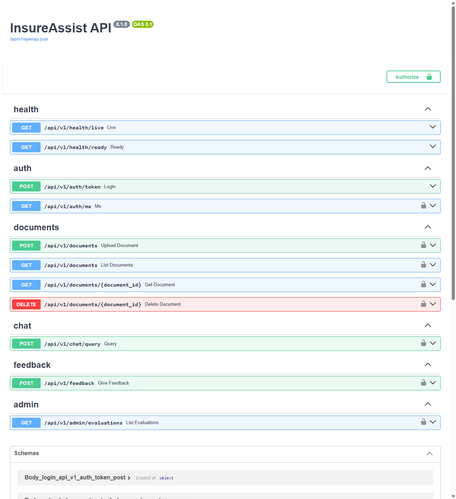
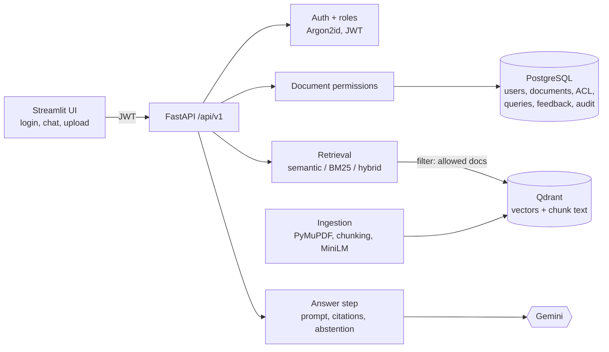
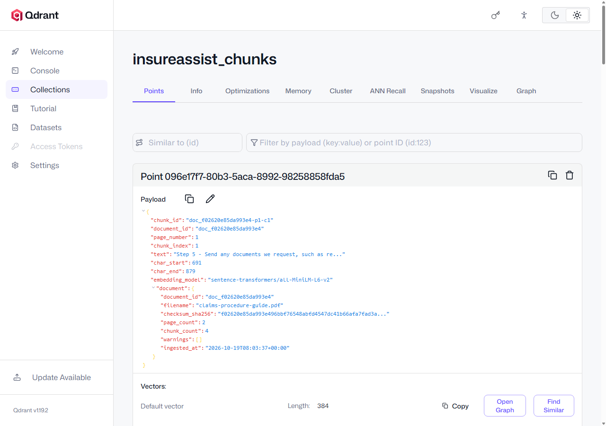

# InsureAssist: Insurance Knowledge Assistant (RAG)

Ask questions about insurance PDFs and get answers **grounded in the documents, with page citations**. When the documents don't contain the answer, it says so instead of guessing. Each user only ever sees answers drawn from the documents **they are allowed to read**.

Built as an end-to-end, production-oriented RAG portfolio project: PDF ingestion, vector search, a Gemini-powered answer step with citation checks, a labelled evaluation set, a secured FastAPI backend, and a web UI.

> **A knowledge assistant, not an insurance decision system.** Answers can be wrong; always check the cited page. All sample documents are synthetic, from a fictional insurer.



<!-- Add your own screenshot of the chat UI here: docs/images/chat-ui.png -->

## What it does

- **Ingests PDFs**: validates them, extracts text page by page, cuts it into sentence-aware chunks (800 characters, never across a page), embeds each chunk (`all-MiniLM-L6-v2`, 384 dimensions) and stores it in **Qdrant** (or FAISS).
- **Answers questions** with **Gemini**: retrieves the 5 most relevant chunks, sends only those as labelled evidence, forces a JSON answer, and keeps only citations that point at evidence it actually sent.
- **Knows when it doesn't know**: skips the LLM entirely for off-topic questions, and keeps "not enough information" answers honest.
- **Spots conflicting documents**: for "What is the collision deductible?" it reports $500 in the policy vs $750 in the amendment, citing both.
- **Enforces permissions inside the search**: a viewer and an editor asking the same question get different answers, because documents a user may not read are never even searched.
- **Measures itself**: a labelled 28-question dataset with Recall@k, MRR and nDCG; semantic, keyword (BM25) and hybrid search compared on it.

## Architecture



| Layer | Technology |
|---|---|
| API | FastAPI, Pydantic, Uvicorn |
| Auth | JWT (HS256), Argon2id password hashing, roles: viewer / editor / admin |
| Database | PostgreSQL 16, SQLAlchemy 2, Alembic migrations |
| Vector database | Qdrant 1.19 (or FAISS), cosine similarity |
| Embeddings | Sentence Transformers `all-MiniLM-L6-v2` (local, CPU) |
| Keyword search | rank-bm25, Reciprocal Rank Fusion for hybrid |
| LLM | Gemini (`google-genai`); optional local Hugging Face model |
| PDF | PyMuPDF |
| UI | Streamlit |
| Quality | pytest (180 tests), Ruff, mypy (strict) |

No LangChain or LlamaIndex: every step is plain, readable Python ([why](docs/decisions/0002-frozen-stack-and-supporting-libraries.md)).

## Results

Retrieval on the labelled dataset (v2: 23 answerable questions over 3 documents):

| Search mode | Recall@1 | MRR | nDCG@5 |
|---|---|---|---|
| **Semantic (default)** | **0.826** | **0.942** | **0.948** |
| Keyword (BM25) | 0.674 | 0.823 | 0.854 |
| Hybrid (RRF) | 0.739 | 0.906 | 0.923 |

- Hybrid search was built, measured, and **not** made the default, because it did not beat semantic search here ([ADR-0005](docs/decisions/0005-hybrid-retrieval-rrf.md)).
- FAISS and Qdrant returned **identical** rankings for all 23 questions ([ADR-0011](docs/decisions/0011-qdrant-vector-database.md)).
- The full answer-quality evaluation is in progress (limited by the Gemini free-tier quota of 20 requests/day).

## Quick start

Prerequisites: [uv](https://docs.astral.sh/uv/), Docker Desktop, and a free [Gemini API key](https://aistudio.google.com/) for answers.

```powershell
git clone <your-repo-url> insureassist; cd insureassist
uv sync                                   # Python 3.12 + dependencies
Copy-Item .env.example .env               # then edit .env:
#   GEMINI_API_KEY=...        your key
#   JWT_SECRET_KEY=...        python -c "import secrets; print(secrets.token_urlsafe(48))"
#   POSTGRES_PASSWORD=...     any strong value (also put it in DATABASE_URL)
#   VECTOR_STORE=qdrant

docker compose up -d                      # PostgreSQL (port 5433) + Qdrant (6333), localhost only
uv run alembic upgrade head               # create the database tables
uv run insureassist seed-demo             # demo users + sample PDFs (logins: data/demo-credentials.txt)
uv run insureassist serve                 # API: http://127.0.0.1:8010/api/v1/docs
uv run streamlit run src/insureassist/ui/app.py   # UI: http://localhost:8501 (second terminal)
```

**Try access control:** sign in as the viewer and ask *"What is the collision deductible?"* (you get $500), then as the editor (you get the conflict: $500 vs $750 from the amendment, which is not shared with viewers).

Other useful commands:

```powershell
uv run pytest                             # 180 tests, no API key or model download needed
uv run insureassist eval                  # score retrieval on the labelled questions
uv run insureassist search "collision deductible"   # see retrieved chunks
```

Qdrant's dashboard (http://localhost:6333/dashboard) shows every stored vector with its text and page:



## Security highlights

- Passwords hashed with **Argon2id**; login rate-limited; the same error for wrong password and unknown user.
- **JWT** with an algorithm allow-list and checked issuer, audience, expiry and token id; roles re-read from the database on every request.
- **Document permissions applied inside the vector search**, re-checked on citations; hidden documents answer 404, exactly like missing ones.
- A test proves text from a forbidden document **never reaches the LLM prompt**.
- Prompt-injection defences: rules separate from evidence, evidence delimited and marked as data, citations validated server-side, model output shown as plain text.
- Uploads streamed with a size limit; checked by content (not file extension); stored under generated names.
- Consistent error format with request ids; no stack traces, SQL or provider messages in responses; audit log of logins, uploads, deletes and access denials.

Full threat model and control status: [docs/security-controls.md](docs/security-controls.md).

## Documentation

| Start here | |
|---|---|
| [docs/explained.md](docs/explained.md) | Plain-language tour of the architecture and every technology choice |
| [docs/architecture.md](docs/architecture.md) | Components and diagrams |
| [docs/api-specification.md](docs/api-specification.md) | Endpoints, errors, role matrix |
| [docs/evaluation-strategy.md](docs/evaluation-strategy.md) | Dataset, metrics, experiments and results |
| [docs/chunking-guide.md](docs/chunking-guide.md) | Chunking strategies and how the size was chosen |
| [docs/decisions/](docs/decisions/) | 12 Architecture Decision Records |
| [docs/runbook.md](docs/runbook.md) | Troubleshooting |

## Limitations and roadmap

- Text PDFs only (no OCR yet); tables are flattened to text.
- One API process; in-memory rate limits (fine for a single server).
- Answer evaluation still running; small, team-written dataset, so real-world scores would be lower.
- Next: full Docker packaging of API and UI with CI (M6), then a cloud deployment plan (M7).

## License

[AGPL-3.0](LICENSE). PyMuPDF, used for PDF parsing, is AGPL-licensed. The sample documents are synthetic.
