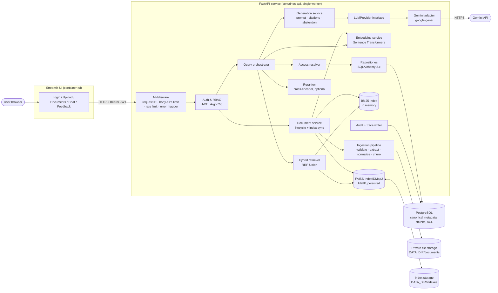
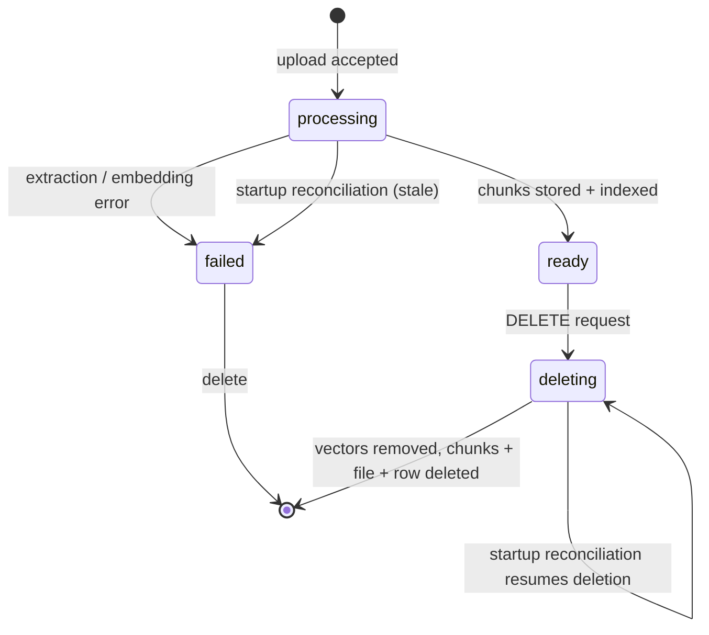
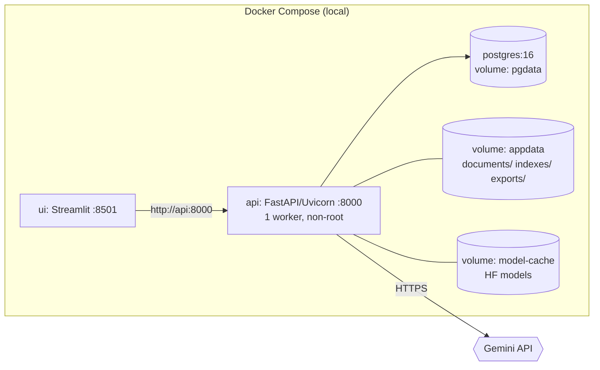

# InsureAssist — Architecture

| Field | Value |
|---|---|
| Status | **Draft for M0 approval** (nothing below is implemented yet) |
| Last updated | 2026-10-18 |
| Related | [requirements.md](requirements.md), [data-models.md](data-models.md), [retrieval-design.md](retrieval-design.md), [security-controls.md](security-controls.md), [decisions/](decisions/) |

## 1. Architectural principles

1. **PostgreSQL is canonical; FAISS and BM25 are derived.** Every index can be rebuilt from canonical chunk records ([ADR-0003](decisions/0003-postgres-canonical-faiss-derived.md)).
2. **Authorization happens before generation.** Retrieval is restricted to authorized documents, and the ACL is checked again just before the prompt is built ([ADR-0004](decisions/0004-authorization-before-generation.md)).
3. **Retrieved text is untrusted.** Document content is treated as data, never as instructions.
4. **Providers can be swapped.** The LLM, the embedder and the reranker sit behind small interfaces, so tests use fakes.
5. **No orchestration frameworks.** The pipeline is plain Python modules ([ADR-0002](decisions/0002-frozen-stack-and-supporting-libraries.md)).
6. **Deterministic and reproducible.** IDs are content-derived ([ADR-0006](decisions/0006-deterministic-identifiers.md)), configuration is versioned, and evaluation runs record their configuration.

## 2. Component view



### 2.1 Module responsibilities

| # | Module (package) | Responsibility | Depends on |
|---|---|---|---|
| 1 | `ui/` | **Implemented (M5):** `src/insureassist/ui/app.py` signs in and calls only the API through `ui/api_client.py`; the admin-only Vector DB developer page reads the local store. Holds the token in `st.session_state` and calls only the public API. | `httpx` |
| 2 | `insureassist.api` | Routers, Pydantic schemas, dependency injection, middleware, error mapping. | services |
| 3 | `insureassist.auth` | Password hashing, JWT issue/verify, current-user dependency, role checks. | `db`, config |
| 4 | `insureassist.ingestion` | PDF validation, page extraction, normalization, chunking, IDs, reports, JSONL export, CLI. | PyMuPDF |
| 5 | `insureassist.retrieval.embeddings` | `Embedder` interface plus Sentence Transformers implementation; batching; normalization. | sentence-transformers |
| 6 | `insureassist.retrieval.vector_index` | FAISS build/add/remove/search/persist/load, manifest, atomic writes. | faiss-cpu |
| 7 | `insureassist.retrieval.keyword_index` | BM25 tokenization, build, scored search over an allowed set. | rank-bm25 |
| 8 | `insureassist.retrieval.hybrid` | Candidate retrieval from both indexes, ACL restriction, RRF fusion, diagnostics. | 5–7 |
| 9 | `insureassist.retrieval.rerank` | `Reranker` interface plus cross-encoder implementation (M4, flag-controlled). | sentence-transformers |
| 10 | `insureassist.generation.providers` | `LLMProvider` protocol, `GeminiProvider`, `FakeProvider` (tests). | google-genai |
| 11 | `insureassist.generation` | Prompt building, structured output parsing, citation validation, abstention and conflict logic. | 10 |
| 12 | `insureassist.db` | SQLAlchemy models, session, repositories, Alembic migrations. JSONL store before M5 ([ADR-0008](decisions/0008-jsonl-canonical-store-before-postgres.md)). | SQLAlchemy, psycopg |
| 13 | `insureassist.evaluation` | Dataset loading/validation, metrics, runners, reports, regression comparison. | 8, 11 |
| 14 | `insureassist.observability` | JSON logging, request-ID context, redaction filter, timing helpers. | stdlib |

**Dependency rule:** `api → services (query, documents) → {retrieval, generation, ingestion} → {db, providers}`. Lower layers never import `api`. `ui` imports nothing from `insureassist`.

## 3. Query flow

```mermaid
sequenceDiagram
    autonumber
    actor U as User
    participant UI as Streamlit UI
    participant API as FastAPI /chat/query
    participant AUTH as Auth
    participant ACL as Access resolver
    participant EMB as Embedder
    participant RET as Hybrid retriever
    participant RR as Reranker (optional)
    participant GEN as Generation service
    participant LLM as Gemini adapter
    participant DB as PostgreSQL

    U->>UI: Ask a question
    UI->>API: POST /api/v1/chat/query (Bearer JWT)
    API->>API: Request ID, size limit, rate limit
    API->>AUTH: Verify JWT (sig, exp, iss, aud)
    AUTH->>DB: Load user + roles (is_active)
    API->>ACL: allowed_document_ids(user) ∩ requested filter
    ACL->>DB: owner / user grants / role grants, status=ready
    alt no accessible documents
        API-->>UI: 200 status=insufficient_evidence
    end
    API->>EMB: embed(question)
    API->>RET: search(qvec, qtext, allowed_vector_ids, candidate_k)
    RET->>RET: FAISS search restricted by IDSelector
    RET->>RET: BM25 scores masked to allowed chunks
    RET->>RET: RRF fusion → top N
    opt RERANKER_ENABLED
        API->>RR: rerank(question, top N)
    end
    API->>DB: Re-check ACL + status for final chunk IDs (defence in depth)
    alt best evidence below threshold
        API-->>UI: 200 status=insufficient_evidence (LLM not called)
    end
    API->>GEN: build prompt (system rules + delimited evidence E1..En)
    GEN->>LLM: generate(structured JSON, timeout, bounded retry)
    LLM-->>GEN: {status, answer, citations[E#]}
    GEN->>GEN: Validate schema and citations ⊆ supplied evidence
    GEN-->>API: QueryResult
    API->>DB: Write retrieval_trace (IDs, scores, latencies; no raw text by default)
    API-->>UI: 200 {query_id, status, answer, citations, disclaimer}
    UI-->>U: Render answer as plain text + sources
    opt user rates answer
        UI->>API: POST /api/v1/feedback
    end
```

## 4. Ingestion flow

```mermaid
sequenceDiagram
    autonumber
    actor E as Editor
    participant API as FastAPI /documents
    participant DOC as Document service
    participant ING as Ingestion pipeline
    participant FS as File storage
    participant DB as PostgreSQL
    participant EMB as Embedder
    participant IDX as FAISS + BM25

    E->>API: POST /api/v1/documents (multipart PDF)
    API->>API: Auth (editor/admin), Content-Length ≤ limit
    API->>DOC: create(upload stream)
    DOC->>DOC: Stream to temp file, SHA-256, size check
    DOC->>DOC: Validate magic bytes, open with PyMuPDF, page count, encryption
    DOC->>DB: Duplicate check by checksum
    alt duplicate
        API-->>E: 409 duplicate_document
    end
    DOC->>FS: Move to DATA_DIR/documents/{document_id}.pdf
    DOC->>DB: Insert document (status=processing) + ACL grants + audit
    API-->>E: 202 {document_id, status: processing}
    Note over DOC,IDX: Background task (single worker, index lock)
    DOC->>ING: extract → normalize → chunk (per page)
    ING-->>DOC: chunks + IngestionReport
    DOC->>DB: Insert chunks (deterministic IDs)
    DOC->>EMB: embed(chunk texts) in batches
    DOC->>IDX: FAISS add_with_ids, persist atomically; rebuild BM25
    DOC->>DB: status=ready (or failed + error_code), report summary
```

## 5. Document lifecycle



**Index synchronization rules**

- Only documents in `ready` state are retrievable. The ACL resolver filters on status, so a document in `processing` or `deleting` is never searchable, even if its vectors exist.
- Deletion order: set `deleting` → remove vectors from FAISS and persist → rebuild BM25 → delete chunks/file/row → audit event. A crash at any step is resumed at startup.
- Readiness compares the FAISS manifest (`vector_id` set hash, embedding model) with the canonical chunk set. A mismatch marks the index `stale`, and an admin runs `rebuild-index` ([runbook.md](runbook.md)).

## 6. Deployment view (local, M6)



Cloud deployment is decided in M7 (provider not yet selected).

## 7. Target repository structure

Directories are created in the milestone that first needs them. M0 creates only `docs/`, `README.md`, `.gitignore` and `.env.example`.

```text
insureassist/
├── README.md
├── pyproject.toml                # M1 — deps, ruff, mypy, pytest config
├── uv.lock                       # M1 (if ADR-0010 approved)
├── .env.example
├── .gitignore
├── alembic.ini                   # M5
├── docs/
│   ├── *.md                      # M0 documentation set
│   └── decisions/                # ADRs
├── src/insureassist/
│   ├── config.py                 # pydantic-settings Settings
│   ├── observability/            # logging, request_id, redaction
│   ├── ingestion/                # validation, extract, normalize, chunking, ids, report, export, cli
│   ├── retrieval/                # embeddings, vector_index, keyword_index, hybrid, rerank, cli
│   ├── generation/               # providers/, prompts, schemas, citations, service
│   ├── storage/                  # chunk store interface, jsonl store (M1–M4)
│   ├── db/                       # models, session, repositories (M5)
│   ├── auth/                     # passwords, tokens, dependencies, rbac (M5)
│   ├── services/                 # documents, query orchestration (M5)
│   ├── api/                      # app factory, routers/, schemas/, errors, middleware (M5)
│   ├── evaluation/               # dataset, metrics, runner, report, compare
│   └── cli.py                    # entry point: ingest, rebuild-index, create-user, eval
├── migrations/                   # Alembic (M5)
├── ui/streamlit_app.py           # M5
├── samples/
│   ├── sources/                  # synthetic document sources (Markdown/YAML)
│   └── pdfs/                     # generated synthetic PDFs (deterministic)
├── eval/
│   ├── datasets/insureassist-eval-v1/   # questions.jsonl, README, CHANGELOG
│   └── reports/baselines/        # committed baseline reports
├── scripts/                      # generate_sample_pdfs.py, smoke_test.py, backup.sh
├── tests/
│   ├── unit/  integration/  security/  e2e/
│   └── fixtures/                 # generated fixture PDFs (incl. malformed, scanned, injection)
├── docker/                       # api.Dockerfile, ui.Dockerfile (M6)
├── docker-compose.yml            # M6
├── .github/workflows/ci.yml      # M6
└── data/                         # git-ignored runtime data (documents, indexes, exports)
```

## 8. Cross-cutting concerns

| Concern | Approach | Doc |
|---|---|---|
| Configuration | `pydantic-settings` `Settings`, environment variables / `.env`, validated at startup, no defaults for secrets. | [.env.example](../.env.example) |
| Errors | Domain exceptions mapped centrally to `{"error": {code, message, request_id}}`; nothing internal leaks. | [api-specification.md](api-specification.md) |
| Logging | JSON lines (stdlib `logging` + formatter), `request_id` via `contextvars`, redaction filter. | [security-controls.md](security-controls.md) |
| Concurrency | Single API worker; an `asyncio`/thread lock serializes index mutations; reads use the current snapshot. | [ADR-0009](decisions/0009-single-process-indexes-and-background-ingestion.md) |
| Model loading | Embedder and reranker load once at startup into the HF cache volume; readiness waits for them. | [deployment-guide.md](deployment-guide.md) |
