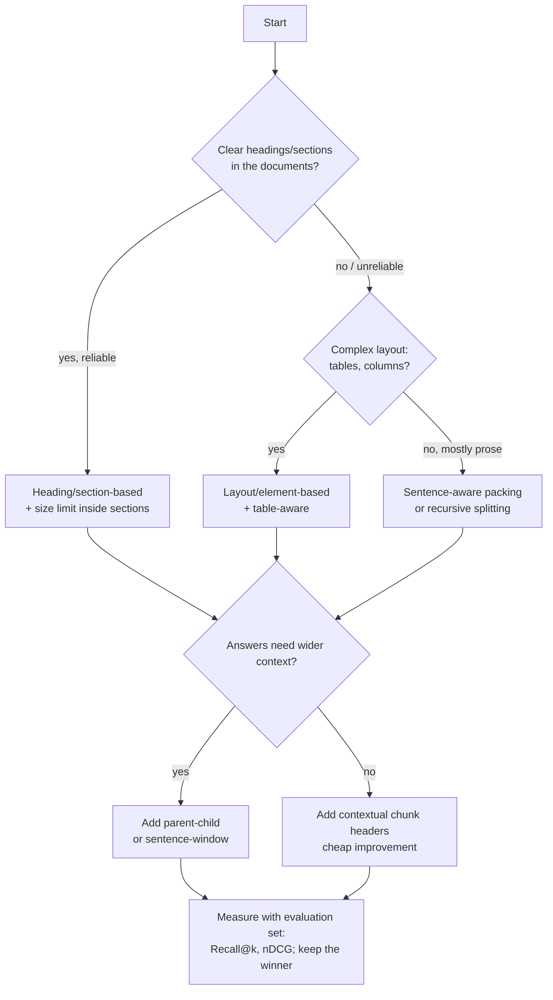

# Chunking Guide: strategies and how to choose chunk size

A reference for InsureAssist. What we actually implement is in [ingestion-design.md](ingestion-design.md).

## 1. How to choose the chunk size

Answer these five questions in order:

| # | Question | Why it matters | InsureAssist answer |
|---|---|---|---|
| 1 | **What is the embedding model's input limit?** | Text beyond the limit is silently cut off and never searched. | `all-MiniLM-L6-v2`: max 256 tokens, trained on ~128. Keep chunks ≤ ~200 tokens. |
| 2 | **What do users ask?** | Short fact questions need small, precise chunks; "explain" questions need bigger ones. | Mostly facts: limits, deductibles, waiting periods, exclusions. So small to medium. |
| 3 | **How is the document structured?** | Chunks should match natural units of meaning. | Policy clauses and paragraphs, ~100–200 words each. |
| 4 | **How much text can the LLM receive?** | `top_k × chunk size` must fit the prompt budget and cost. | 5 × 800 chars ≈ 1,000 tokens. Easily fits. |
| 5 | **How precise must citations be?** | Bigger chunks mean vaguer citations. | Page-level citations, so a chunk must stay within one page. |

**Rules of thumb**

| Question style | Typical chunk size | Overlap |
|---|---|---|
| Short facts (FAQ, policy terms) | 100–300 tokens (~400–1,200 chars) | 10–20% |
| General documents | 300–600 tokens | 10–20% |
| Long explanations, legal reasoning | 600–1,000+ tokens (needs a model with a long input limit) | 10–15% |

**Conversion:** in English, 1 token ≈ 4 characters ≈ 0.75 words. 800 chars ≈ 200 tokens ≈ 130–150 words.

**Too small** loses context ("it is excluded"… what is?) and spreads one fact over several chunks.
**Too large** blends several topics into one embedding, so search matches become fuzzy, citations get vague and LLM cost rises.

**Final rule:** pick a sensible default, then **measure**. Run the evaluation set at 2–3 sizes (e.g. 500 / 800 / 1,200 chars) and keep the one with the best Recall@k and nDCG (planned M4 experiment E2).

## 2. All chunking strategies

### A. Size-based (simple)

| # | Strategy | How it works | Pros | Cons |
|---|---|---|---|---|
| 1 | **Fixed-size (characters)** | Cut every N characters | Trivial, predictable | Cuts words and sentences in half |
| 2 | **Fixed-size (tokens)** | Cut every N model tokens | Exactly matches the model limit | Still cuts sentences; needs the tokenizer |
| 3 | **Sliding window** | Fixed size + overlap (e.g. 500 with 100 overlap) | Boundary facts appear twice | Still cuts mid-sentence; more chunks to store |

### B. Text-boundary-based

| # | Strategy | How it works | Pros | Cons |
|---|---|---|---|---|
| 4 | **Sentence-based** | Exactly N sentences per chunk | Never breaks sentences | Chunk sizes vary a lot |
| 5 | **Sentence-aware packing** ✅ *ours* | Whole sentences until the size limit, sentence overlap | Clean chunks with a size limit | Rule-based sentence splitting has edge cases |
| 6 | **Paragraph-based** | One paragraph = one chunk | Natural units of meaning | Paragraph sizes vary from 1 line to a page |
| 7 | **Recursive splitting** | Try paragraph breaks; if too big, sentences; then words | Respects structure and size | More complex (popular in LangChain) |

### C. Structure-based

| # | Strategy | How it works | Pros | Cons |
|---|---|---|---|---|
| 8 | **Page-based** | One page = one chunk | Perfect page citations | Pages are usually too big for small embedding models |
| 9 | **Heading/section-based** | Cut at "SECTION 4", "Exclusions", Markdown `#` | Matches how policies are written | PDFs don't reliably mark headings |
| 10 | **Layout/element-based** | A layout parser detects titles, lists, tables, paragraphs | Best for complex PDFs | Extra heavy tools (Unstructured, Docling); slower |
| 11 | **Table-aware** | Keep each table (or table row + header) together | Numbers stay with their labels | Needs table detection |

### D. Meaning-based

| # | Strategy | How it works | Pros | Cons |
|---|---|---|---|---|
| 12 | **Semantic chunking** | Embed each sentence; cut where the similarity between neighbours drops (topic change) | Topic-coherent chunks | Slow, needs embeddings at chunk time, hard to test |
| 13 | **Proposition-based** | An LLM rewrites the text into small standalone facts | Very precise retrieval | Expensive; the LLM may alter meaning |
| 14 | **Agentic / LLM-decided** | An LLM decides where to cut | Adapts to any document | Costly, non-deterministic |

### E. Retrieval-enhancing (combined with any strategy above)

| # | Strategy | How it works | Pros | Cons |
|---|---|---|---|---|
| 15 | **Parent-child (hierarchical)** | Search small chunks; send the bigger parent section to the LLM | Precise search + full context | Two levels to store and keep in sync |
| 16 | **Sentence-window retrieval** | Embed single sentences; return ±N surrounding sentences | Very precise match + context | Many vectors |
| 17 | **Contextual chunk headers** | Prepend "Document: Auto Policy › Section 4 Deductibles" to each chunk before embedding | Cheap; fixes "it is excluded" chunks lacking context | Slightly longer chunks |
| 18 | **Contextual retrieval (LLM)** | An LLM writes a 1–2 sentence context for each chunk | Strong reported gains | One LLM call per chunk at ingestion (cost) |
| 19 | **Late chunking** | Embed the whole document with a long-context model, then split the token embeddings into chunks | Each chunk "knows" the whole document | Needs special long-context embedding models |

### F. Format-specific

| # | Strategy | Used for |
|---|---|---|
| 20 | **Q&A pair** | FAQs: one question + answer = one chunk |
| 21 | **Code-aware** | Source code: one function/class per chunk |
| 22 | **Record-based** | JSON/CSV/email: one record or message per chunk |

## 3. Decision guide

## 4. What InsureAssist does and may try

| Status | Strategy | Reason |
|---|---|---|
| ✅ Implemented | #5 Sentence-aware packing, 800 chars, 120 overlap, page-bounded | Simple, clean chunks, exact page citations, fits the 256-token model limit |
| 🧪 M4 experiment | Chunk sizes 500 / 1,000 | Measure, don't guess. 1,200 was dropped: see the measurement below |
| 🧪 M4 candidate | #17 Contextual chunk headers (document title + detected section) | Cheapest likely gain for policy text |
| 🧪 M4 candidate | #9 Heading-based, if sample PDFs have reliable "SECTION n" headings | Matches policy structure |
| 💤 Later, if needed | #15 Parent-child, #11 Table-aware | Only if the evaluation shows missing context or broken tables |
| ❌ Not planned | #12–14, #18–19 | Cost or complexity is not justified at this scale |

## 5. Measured: characters → tokens for `all-MiniLM-L6-v2` (2026-10-18)

Measured on policy-style text (numbers, form codes, "e.g."), using the model's own tokenizer:

| Chunk size | Tokens | Fits the 256-token limit? |
|---|---|---|
| 500 chars | 113 | ✅ |
| **800 chars (default)** | **181** | ✅ (~30% headroom) |
| 1,200 chars | 277 | ❌ the end of the chunk would be silently ignored |
| 1,500 chars | 351 | ❌ |

Insurance text runs about **4.4 characters per token**. With this model, the maximum safe chunk size is about **1,000 characters**. A larger chunk size only makes sense with a model that has a longer input limit.
