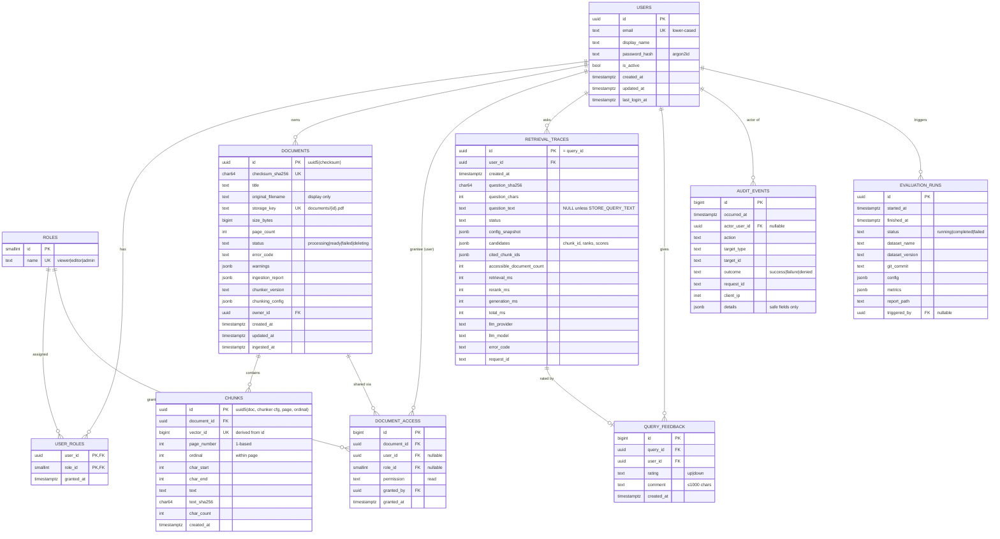

# InsureAssist — Data Models

| Field | Value |
|---|---|
| Status | **Draft for M0 approval** (schema is implemented with Alembic in M5) |
| Last updated | 2026-10-18 |
| Related | [architecture.md](architecture.md), [ADR-0003](decisions/0003-postgres-canonical-faiss-derived.md), [ADR-0006](decisions/0006-deterministic-identifiers.md), [ADR-0008](decisions/0008-jsonl-canonical-store-before-postgres.md) |

## 1. Principles

- PostgreSQL is the canonical store for users, ACLs, documents and chunk text. FAISS and BM25 are derived from it.
- Document and chunk IDs are **deterministic, readable strings**: `doc_<16 hex>` and `doc_…-p3-c0` ([ADR-0006](decisions/0006-deterministic-identifiers.md), revised). In M5 the `documents.id` / `chunks.id` columns become `text` holding these values. The ERD below still shows the original UUIDv5 proposal and will be updated in M5. Other tables (users, traces, feedback) use UUIDv4.
- All timestamps are `timestamptz` in UTC.
- Operational tables (`retrieval_traces`, `audit_events`) store IDs, hashes and numbers. They do not store raw question text, prompts, document text or credentials, unless `STORE_QUERY_TEXT=true` is set explicitly.
- Every query goes through SQLAlchemy 2.x with bound parameters. No string-built SQL.
- Before M5, `Document` and `Chunk` records live in JSONL files with the **same field names**, so they import directly ([ADR-0008](decisions/0008-jsonl-canonical-store-before-postgres.md)).

## 2. Entity-relationship diagram



## 3. Table details, constraints and indexes

### 3.1 `users`, `roles`, `user_roles`

| Constraint / index | Purpose |
|---|---|
| `users.email` UNIQUE, CHECK `email = lower(email)` | Case-insensitive uniqueness without the `citext` extension. |
| `roles.name` UNIQUE, seeded by migration with `viewer`, `editor`, `admin` | Fixed role set. |
| `user_roles` PK (`user_id`, `role_id`), FK ON DELETE CASCADE | Many-to-many. |

Users are deactivated (`is_active=false`) rather than deleted, so the audit history keeps its references.

### 3.2 `documents`

| Constraint / index | Purpose |
|---|---|
| `checksum_sha256` UNIQUE | Deterministic duplicate detection (FR-ING-05). |
| CHECK `status IN ('processing','ready','failed','deleting')` | Lifecycle integrity. |
| CHECK `size_bytes > 0`, `page_count >= 0` | Sanity checks. |
| `storage_key` UNIQUE, server-generated | No user-controlled paths. |
| INDEX (`status`), INDEX (`owner_id`) | ACL resolution and listing. |
| FK `owner_id → users.id` ON DELETE RESTRICT | Owners are deactivated, not deleted. |

`original_filename` is sanitized (base name only, control characters stripped, ≤ 255 chars) and used **only for display**.

### 3.3 `chunks`

| Constraint / index | Purpose |
|---|---|
| FK `document_id` ON DELETE CASCADE | Deleting a document deletes its chunks. |
| UNIQUE (`document_id`, `page_number`, `ordinal`) | One chunk per position. |
| `vector_id` UNIQUE | Stable FAISS ID. A collision fails the insert, which surfaces derivation collisions. |
| CHECK `page_number >= 1`, `char_end > char_start` | Provenance integrity. |
| INDEX (`document_id`) | Deletion, ACL → vector-ID mapping. |

`vector_id` = first 8 bytes of `chunk.id` read as a big-endian integer, masked to 63 bits (FAISS IDs are signed `int64`). See [retrieval-design.md §3](retrieval-design.md).

### 3.4 `document_access`

| Constraint / index | Purpose |
|---|---|
| CHECK `(user_id IS NULL) <> (role_id IS NULL)` | A grant targets exactly one user **or** one role. |
| UNIQUE (`document_id`, `user_id`) WHERE `user_id IS NOT NULL` | No duplicate user grants (partial unique index). |
| UNIQUE (`document_id`, `role_id`) WHERE `role_id IS NOT NULL` | No duplicate role grants. |
| CHECK `permission = 'read'` | Only read exists in v1; the column is kept for future write/manage permissions. |
| INDEX (`user_id`), INDEX (`role_id`) | ACL resolution. |
| FK `document_id` ON DELETE CASCADE | Grants go away with the document. |

The owner is **not** stored as a grant; ownership is checked through `documents.owner_id`.

### 3.5 `retrieval_traces` and `query_feedback`

- `retrieval_traces.id` is the `query_id` returned to the client.
- `candidates` JSONB: `[{"chunk_id", "document_id", "page_number", "semantic_rank", "semantic_score", "bm25_rank", "bm25_score", "rrf_score", "rerank_score"}]`, with no chunk text.
- `query_feedback` UNIQUE (`query_id`, `user_id`); FK `query_id` ON DELETE CASCADE.
- Chunk and document IDs inside JSONB are plain strings (no FK), so a document deletion does not break historical traces.
- INDEX `retrieval_traces(user_id, created_at DESC)`.

### 3.6 `audit_events`

Append-only. The application role gets INSERT/SELECT only (enforced in M6 through DB grants where practical).

| `action` values (v1) | `target_type` |
|---|---|
| `auth.login_success`, `auth.login_failure`, `auth.token_rejected` | `user` |
| `document.upload`, `document.ingest_ready`, `document.ingest_failed`, `document.delete` | `document` |
| `document.access_denied` | `document` |
| `access.grant_added`, `access.grant_removed` | `document` |
| `index.rebuild` | `index` |
| `evaluation.run` | `evaluation_run` |

For `auth.login_failure`, `details` stores `email_sha256`, not the raw email (a typo can expose a password fragment). INDEX (`occurred_at`), INDEX (`actor_user_id`, `occurred_at`).

### 3.7 `evaluation_runs`

`config` records the embedding model name and revision, chunker version and parameters, `candidate_k`, `top_k`, RRF `k`, reranker on/off and model, LLM provider/model/temperature, and judge model (if used). `metrics` holds the aggregate metrics; per-question results go to the report file at `report_path`.

## 4. Pydantic domain records (shared by JSONL and DB)

```text
DocumentRecord: document_id, checksum_sha256, title, original_filename, size_bytes,
                page_count, status, warnings[], chunker_version, chunking_config,
                created_at, ingested_at
ChunkRecord:    chunk_id, document_id, vector_id, page_number, ordinal,
                char_start, char_end, text, text_sha256, char_count
IngestionReport: document_id, original_filename, checksum_sha256, status, error_code?,
                page_count, pages_with_text, pages_likely_scanned[], chunk_count,
                warnings[{code, page?, message}], timings_ms{validate, extract, chunk, total},
                chunker_version, chunking_config
```

## 5. Retention (defaults; configurable later)

| Data | Default retention | Notes |
|---|---|---|
| Documents, chunks, files | Until deleted by owner/admin | Hard delete (NFR-PRIV-02). |
| `retrieval_traces` | 90 days | A purge CLI is planned for M6. |
| `query_feedback` | 1 year | Removed with its trace if the trace is purged first. |
| `audit_events` | 1 year | Kept longer than traces for security review. |
| Backups | Documented in the [runbook](runbook.md) | Deleted documents remain in older backups until those expire; this is documented as a limitation. |
