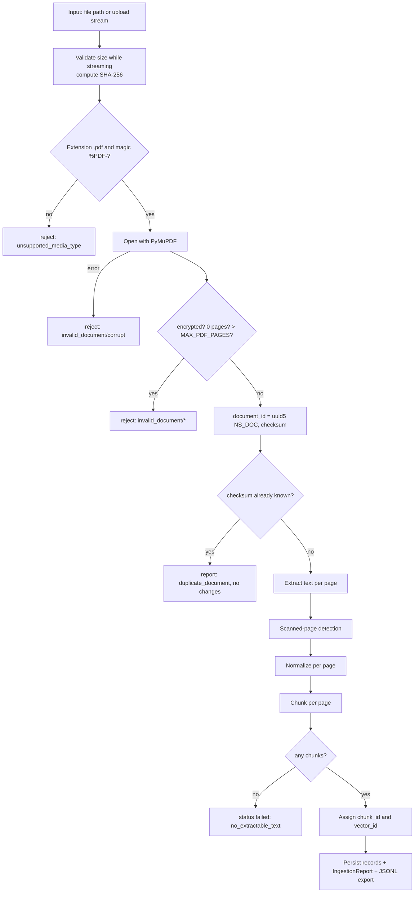

# InsureAssist — Ingestion Design

| Field | Value |
|---|---|
| Status | **Draft for M0 approval** (implemented in M1) |
| Last updated | 2026-10-18 |
| Related | [ADR-0006](decisions/0006-deterministic-identifiers.md), [ADR-0007](decisions/0007-page-bounded-chunking.md), [data-models.md](data-models.md) |

## 1. Pipeline



M1 delivers this pipeline as a library plus a CLI (`insureassist ingest <paths…>`) that writes to the JSONL store. M5 calls the same pipeline from the API's background task.

## 2. Validation

| Check | Rule | Error code |
|---|---|---|
| Size | `0 < size ≤ MAX_UPLOAD_MB × 1024²`, enforced while streaming | `payload_too_large` / `invalid_document:empty_file` |
| Type | Extension `.pdf` (case-insensitive) **and** first 1024 bytes contain `%PDF-` | `unsupported_media_type` |
| Parse | `pymupdf.open(stream=…, filetype="pdf")` succeeds | `invalid_document:corrupt` |
| Encryption | `doc.needs_pass` is false | `invalid_document:encrypted` |
| Pages | `1 ≤ page_count ≤ MAX_PDF_PAGES` | `invalid_document:no_pages` / `invalid_document:too_many_pages` |
| Time budget | Total extraction ≤ `INGEST_TIMEOUT_SECONDS` (checked between pages) | `invalid_document:timeout` |

Validation failures leave **no** document, chunk or file behind. Temporary files are removed in `finally`.

## 3. Extraction

- `page.get_text("text", sort=True)` for each page (reading order sorted top-left to bottom-right). The `"blocks"` mode is evaluated in M1 tests for multi-column layouts. The chosen mode is recorded in `chunking_config.extraction_mode`.
- `page_number` is **1-based** and matches the number a PDF viewer shows for the physical page. Printed page labels are ignored in v1.

### Scanned-page detection

A page is flagged as *likely scanned* when its normalized text is under `SCANNED_PAGE_MIN_CHARS` (default 25) **and** it contains at least one image covering ≥ 50% of the page area (`page.get_image_info()`).

| Outcome | Result |
|---|---|
| All pages likely scanned / no text at all | status `failed`, `error_code = no_extractable_text`, warning `likely_scanned` |
| Some pages likely scanned | status ready, warning `likely_scanned` with page numbers: "OCR is not supported in this version" |
| Empty page without images | warning `empty_page` (informational) |

## 4. Normalization (per page, in order)

1. Unicode NFKC (ligatures `fi` → `fi`, full-width forms).
2. Remove soft hyphens (U+00AD) and zero-width characters; convert NBSP to a space.
3. De-hyphenate line-break hyphenation: `cover-\nage` → `coverage`. Only `[a-z]-\n[a-z]` is joined, so real hyphenated compounds at the end of a line are mostly preserved (known limitation).
4. Join wrapped lines inside a paragraph; keep blank lines as paragraph breaks.
5. Collapse runs of spaces/tabs; trim.
6. *(Planned but off by default)* Repeated header/footer removal: lines that appear identically on ≥ 60% of pages. This is evaluated in M4 as a single-variable experiment.

Normalization never changes the page assignment. `char_start`/`char_end` refer to the **normalized** page text.

## 5. Chunking ([ADR-0007](decisions/0007-page-bounded-chunking.md))

| Parameter | Default | Setting |
|---|---|---|
| Target max size | 800 characters | `CHUNK_SIZE_CHARS` |
| Overlap | 120 characters | `CHUNK_OVERLAP_CHARS` |
| Minimum size | 50 characters | `CHUNK_MIN_CHARS` |
| Chunker version | `v1` | code constant |

**Algorithm (per page):**

1. Split the page into paragraphs, then sentences (a regex splitter that is aware of abbreviations like "e.g.", "No.", "Sec."; no NLP dependency).
2. Greedily pack whole sentences until adding the next one would exceed `CHUNK_SIZE_CHARS`.
3. A single sentence longer than the limit is split at whitespace boundaries.
4. The next chunk starts with the trailing sentences of the previous chunk whose total length is ≤ `CHUNK_OVERLAP_CHARS`, as long as the next chunk still has room for at least one new sentence (this guarantees progress). *Implemented simplification:* if the last sentence is longer than the overlap, there is no overlap for that boundary (no character-level overlap).
5. A final fragment under `CHUNK_MIN_CHARS` is merged into the previous chunk on the same page **only if the merged chunk still fits within `CHUNK_SIZE_CHARS`**, so no chunk ever exceeds the size.
6. Constraint: `overlap < size`, validated in `Settings`.
7. Chunk ID (implemented): `{document_id}-p{page_number}-c{chunk_index}`, e.g. `doc_c7584659c99adeb2-p1-c0`. It is readable and deterministic. Changing the chunk settings means re-ingesting everything (an index rebuild), because the IDs do not encode the settings.

**Why characters and not tokens:** `all-MiniLM-L6-v2` truncates input at 256 word pieces. 800 characters of English is about 160–220 word pieces, which stays under that limit without coupling the ingestion code to a tokenizer. M2 measures the truncation rate with the real tokenizer and reports it. If it is above 1%, the default size is lowered (recorded as an evaluation finding).

## 6. Identifiers ([ADR-0006](decisions/0006-deterministic-identifiers.md))

> **Implemented (step 1):** `document_id = "doc_" + sha256(file_bytes)[:16]` in `ingestion/pdf_reader.py`. The block below is the original proposal. Chunk and vector IDs will be finalized in steps 2 and 4.

```text
NS_DOC   = fixed project UUID constant (in code, never changes)
document_id = uuid5(NS_DOC, checksum_sha256)
chunking_config_id = sha256(canonical_json({chunker_version, size, overlap, min, extraction_mode, normalization flags}))[:16]
chunk_id = uuid5(document_id, f"{chunking_config_id}:{page_number}:{ordinal}")
vector_id = int.from_bytes(chunk_id.bytes[:8], "big") & 0x7FFF_FFFF_FFFF_FFFF
```

- The same bytes always give the same `document_id`. The same bytes and config always give the same chunk IDs.
- Changing the chunking configuration changes chunk IDs, which forces an index rebuild.

## 7. Duplicate handling (deterministic)

| Case | Behaviour |
|---|---|
| Same checksum already present (any status except `deleting`) | No changes; report `status = duplicate`, `existing_document_id`; API 409. |
| Same checksum present with status `deleting` | 409 `invalid_state`: "deletion in progress, retry later". |
| Same content, different filename/title | Still a duplicate (content identity). |
| Same filename, different content | Different documents (filenames are not identity). |
| Re-ingest after a chunking config change | A rebuild command (M2) regenerates chunks for every document; ingest itself does not re-chunk existing documents. |

## 8. Ingestion report

The report is a JSON object (schema `IngestionReport` in [data-models.md §4](data-models.md)), written to `DATA_DIR/exports/reports/{document_id}.json` in M1 and stored in `documents.ingestion_report` from M5.

```json
{
  "document_id": "…", "original_filename": "sample-auto-policy.pdf",
  "checksum_sha256": "…", "status": "ready", "error_code": null,
  "page_count": 12, "pages_with_text": 12, "pages_likely_scanned": [],
  "chunk_count": 41,
  "warnings": [{"code": "empty_page", "page": 12, "message": "Page has no text."}],
  "timings_ms": {"validate": 8, "extract": 95, "chunk": 12, "total": 120},
  "chunker_version": "v1",
  "chunking_config": {"size": 800, "overlap": 120, "min": 50, "extraction_mode": "text_sorted"}
}
```

A CLI batch run also prints a summary table (ingested / duplicate / failed counts) and exits non-zero if any file failed. Use `--allow-failures` to override.

## 9. JSONL export

`DATA_DIR/exports/documents.jsonl` and `DATA_DIR/exports/chunks.jsonl`, one Pydantic-serialized record per line, sorted by (`document_id`) and (`document_id`, `page_number`, `ordinal`) so the output is deterministic. Writes are atomic: write `*.tmp`, then `os.replace`.

## 10. Test fixtures (generated, synthetic)

PDFs are generated by `scripts/generate_sample_pdfs.py` with PyMuPDF, so nothing binary needs to be hand-made and nothing is copyrighted:

| Fixture | Purpose |
|---|---|
| `three_pages_known_text.pdf` | Page provenance |
| `long_page.pdf` | Multi-chunk page, overlap |
| `empty_text.pdf` | No text at all |
| `image_only.pdf` | Scanned detection |
| `mixed_scanned.pdf` | Per-page warning |
| `encrypted.pdf` | Rejection |
| `truncated.pdf` (bytes cut) / `not_a_pdf.pdf` (text renamed) | Malformed handling |
| `hyphenation_ligatures.pdf` | Normalization |
| `prompt_injection.pdf` | Used later by SEC-07 |

## 11. Known limitations (v1)

- No OCR; tables are flattened to text; multi-column reading order may be imperfect.
- A chunk never spans two pages, so a sentence split across a page break is split into two chunks.
- Header/footer removal is off by default.
