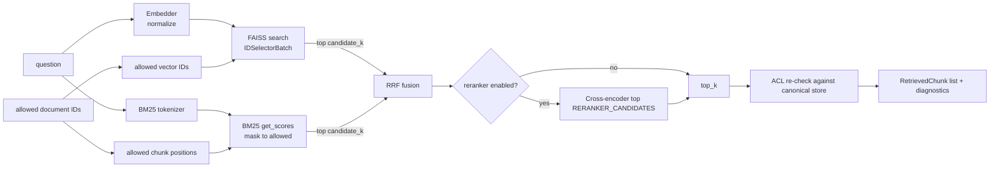

# InsureAssist — Retrieval Design

| Field | Value |
|---|---|
| Status | **Draft for M0 approval** (implemented in M2; reranking in M4) |
| Last updated | 2026-10-18 |
| Related | [ADR-0004](decisions/0004-authorization-before-generation.md), [ADR-0005](decisions/0005-hybrid-retrieval-rrf.md), [ADR-0006](decisions/0006-deterministic-identifiers.md), [evaluation-strategy.md](evaluation-strategy.md) |

## 1. Overview



## 2. Embedding service

- An `Embedder` protocol with `embed_documents(texts) -> np.ndarray[float32]`, `embed_query(text)`, `dimension`, `model_id`.
- `SentenceTransformerEmbedder(EMBEDDING_MODEL_NAME, device=EMBEDDING_DEVICE, batch_size=EMBEDDING_BATCH_SIZE)` with `normalize_embeddings=True`. Default `sentence-transformers/all-MiniLM-L6-v2` (384 dimensions, max 256 word pieces).
- The model revision (HF commit hash) is resolved at load time and recorded in the index manifest and in evaluation runs.
- Tests use `HashEmbedder`, a deterministic, dependency-free fake that maps token hashes to a fixed-dimension unit vector. Tests that need the real model are marked `slow`.
- M2 reports the **truncation rate**: the share of chunks with more than 256 word pieces (see [ingestion-design.md §5](ingestion-design.md)).
- **Implemented (ingestion step 3):** [embedder.py](../src/insureassist/ingestion/embedder.py) contains `SentenceTransformerEmbedder` (one `embed()` method for both chunks and questions, since MiniLM needs no query prefix) and `count_tokens()`. Measured: 800 chars ≈ 181 tokens (fits); 1,200 chars ≈ 277 tokens (truncated). Speed: 100 chunks in 3.2 s on CPU; model load ~16 s.

## 3. FAISS vector index

| Aspect | Decision |
|---|---|
| Index type | `IndexIDMap2(IndexFlatIP(dim))`: exact inner product, which equals cosine because vectors are normalized |
| IDs | `vector_id` (int64) derived from `chunk_id` ([ADR-0006](decisions/0006-deterministic-identifiers.md)) |
| Mapping | `vector_id → chunk_id` is held in memory (built from the canonical store); `document_id → [vector_id]` for ACL selection |
| Add / remove | `add_with_ids`, `remove_ids(IDSelectorBatch)` |
| ACL search | `index.search(q, k, params=faiss.SearchParameters(sel=faiss.IDSelectorBatch(allowed_ids)))` |
| Persistence | `DATA_DIR/indexes/faiss/index.faiss` + `manifest.json`, written atomically (`.tmp` + `os.replace`), protected by an index lock |
| Scale | Exact search is fine up to ~50k × 384 floats (~77 MB). IVF/HNSW would be an ADR change at larger scale |

> **Implemented (ingestion step 4), simplified:** [vector_store.py](../src/insureassist/ingestion/vector_store.py) uses `IndexFlatIP` with **row position = vector ID** (row N ↔ line N of `chunks.jsonl`), not `IndexIDMap2`. Files: `index.faiss`, `chunks.jsonl`, `info.json` (embedding model, dimension, document list), each written atomically. Delete = rebuild from the kept vectors. The ACL filter uses `IDSelectorBatch` over allowed rows. Loading refuses an index built by a different model (`IncompatibleIndexError`). The manifest below (ID-set hash, revision) is the M5 target.

**Manifest:**

```json
{
  "format_version": 1,
  "embedding_model": "sentence-transformers/all-MiniLM-L6-v2",
  "embedding_model_revision": "<hf-commit>",
  "dimension": 384,
  "normalized": true,
  "vector_count": 4123,
  "vector_id_set_sha256": "<sha256 of sorted vector ids>",
  "chunking_config_ids": ["…"],
  "built_at": "2026-…Z",
  "app_version": "0.x.y"
}
```

**Startup consistency check:** load the index and manifest, then compare model name/revision/dimension with the configuration and `vector_id_set_sha256` with the canonical store.

| Result | Index state | Effect |
|---|---|---|
| Match | `ok` | Ready |
| File missing | `missing` | Readiness 503 |
| Model or dimension mismatch | `stale` | Readiness 503 |
| ID set mismatch | `stale` | Readiness 503 |

Recovery is `insureassist rebuild-index` ([runbook.md](runbook.md)). An optional `INDEX_AUTO_REBUILD=true` setting rebuilds at startup instead (off by default, because a rebuild re-embeds every chunk).

**Rebuild:** read every chunk of `ready` documents from the canonical store in a deterministic order, embed in batches, build a new index in a temporary file, verify the count and ID set, then swap it in atomically. The old index keeps serving until the swap.

## 4. BM25 keyword index

> **Implemented (B2):** [keyword_search.py](../src/insureassist/retrieval/keyword_search.py), `KeywordIndex` over `BM25Okapi` defaults. Tokenizer: NFKC + lowercase, `1,500` → `1500`, codes kept whole **and** split (`ap-rs-12`, `ap`, `rs`, `12`), small stopword list that keeps `not`/`no`. Rebuilt in memory from the store's chunks; never persisted. [search.py](../src/insureassist/retrieval/search.py) selects `semantic`, `keyword` or `hybrid` by name (the B2 `retrievers.py` was replaced in B3).

- `rank_bm25.BM25Okapi` (`k1=1.5`, `b=0.75`, library defaults, recorded in configuration).
- Tokenizer v1: lowercase → NFKC → regex `[a-z0-9]+(?:[.\-/][a-z0-9]+)*`, which keeps tokens like `ho-3`, `5,000` → `5`/`000`(†), and `sec.4.2`. A small English stopword list is applied; there is no stemming. The tokenizer version is recorded.
  †Number handling (`5,000` vs `5000`) is a known issue; M4 tests a normalization rule for it.
- `rank-bm25` has no incremental updates, so the index is **rebuilt in memory** from canonical chunks at startup and after each ingest or delete. This is cheap at v1 scale (seconds for 50k chunks) and is not persisted.
- ACL handling: `get_scores(query_tokens)` returns scores for the full corpus; scores at non-allowed positions are set to `-inf` before the top `candidate_k` is taken. Chunks with a score ≤ 0 (no term overlap) are excluded.

## 5. Hybrid fusion ([ADR-0005](decisions/0005-hybrid-retrieval-rrf.md))

> **Implemented (B3):** `Searcher` in [search.py](../src/insureassist/retrieval/search.py) runs both searches with the same document filter and returns `results`, `best_semantic_score` and `keyword_matches`. Modes: `semantic` (**default**; hybrid showed no measured gain), `keyword`, `hybrid`. **Abstention rule as implemented:** skip the LLM when `best_semantic_score < RETRIEVAL_MIN_SEMANTIC_SCORE` **and** `keyword_matches == 0`. BM25 matches are detected by shared words, not `score > 0`, because BM25Okapi gives a word found in exactly half of the chunks an IDF of 0.

Reciprocal Rank Fusion: `rrf(d) = Σ_r 1 / (RRF_K + rank_r(d))`, with `RRF_K = 60` and 1-based ranks, over the semantic and BM25 lists. RRF is used because cosine scores and BM25 scores are on incomparable scales, and it needs no score calibration.

- Ties are broken by semantic score, then `chunk_id` (deterministic).
- Defaults: `RETRIEVAL_CANDIDATE_K = 50` per retriever, `RETRIEVAL_TOP_K = 5` final.
- Every result carries diagnostics: `semantic_rank`, `semantic_score`, `bm25_rank`, `bm25_score`, `rrf_score`, (`rerank_score`).
- Alternatives (weighted score fusion, semantic-only, BM25-only) are run as M4 ablations.

## 6. Abstention signal from retrieval

The query is answered with `insufficient_evidence` **without calling the LLM** when either:

1. there are no candidates after ACL filtering, or
2. `max(semantic_score) < RETRIEVAL_MIN_SEMANTIC_SCORE` **and** no BM25 hit exists among the top `top_k`, or (when the reranker is on) the top rerank score is below `RERANKER_MIN_SCORE`.

The initial threshold of 0.30 is a placeholder. M4 tunes it on the answerable and unanswerable evaluation splits and records the trade-off curve.

## 7. Reranking (M4, flag-controlled)

- `CrossEncoderReranker(RERANKER_MODEL_NAME)`, default `cross-encoder/ms-marco-MiniLM-L-6-v2`. It scores (question, chunk) pairs for the top `RERANKER_CANDIDATES` (20) fused results and keeps `top_k`.
- `RERANKER_ENABLED=false` by default. It is switched on only if M4 shows a meaningful gain (e.g. nDCG@5 +0.03 or more) at acceptable latency (+p95 ≤ 500 ms on CPU).

## 8. Authorization in retrieval ([ADR-0004](decisions/0004-authorization-before-generation.md))

1. `AccessResolver.allowed_document_ids(user)` runs the SQL in [requirements.md §4](requirements.md) (status `ready` only).
2. Intersect with the optional request filter `document_ids`.
3. Translate to allowed vector IDs and BM25 positions with in-memory maps.
4. Search FAISS with the selector and mask BM25.
5. **Re-check:** load final chunks by ID from the canonical store, joined with documents, filtered again by the ACL and `status='ready'`. Drop anything that fails, audit it and raise an internal alert metric.
6. Only the re-checked chunk text is passed to generation.

Selector-based search avoids the "search the global top-k, then post-filter" failure mode, where a user with access to a few documents gets zero results because the global top-k is filled by documents they cannot see.

## 9. Interfaces (sketch)

```python
class RetrievedChunk(BaseModel):
    chunk_id: UUID; document_id: UUID; page_number: int; text: str
    semantic_rank: int | None; semantic_score: float | None
    bm25_rank: int | None; bm25_score: float | None
    rrf_score: float; rerank_score: float | None

class HybridRetriever:
    def search(self, question: str, allowed_document_ids: frozenset[UUID],
               top_k: int, candidate_k: int) -> list[RetrievedChunk]: ...
```

## 10. Known limitations

- The in-memory BM25 and FAISS indexes are per process, so only one API worker is supported in v1.
- The embedding model is English-centric and has a 256-word-piece limit.
- Exact search scales linearly; the corpus assumption is A-02.
